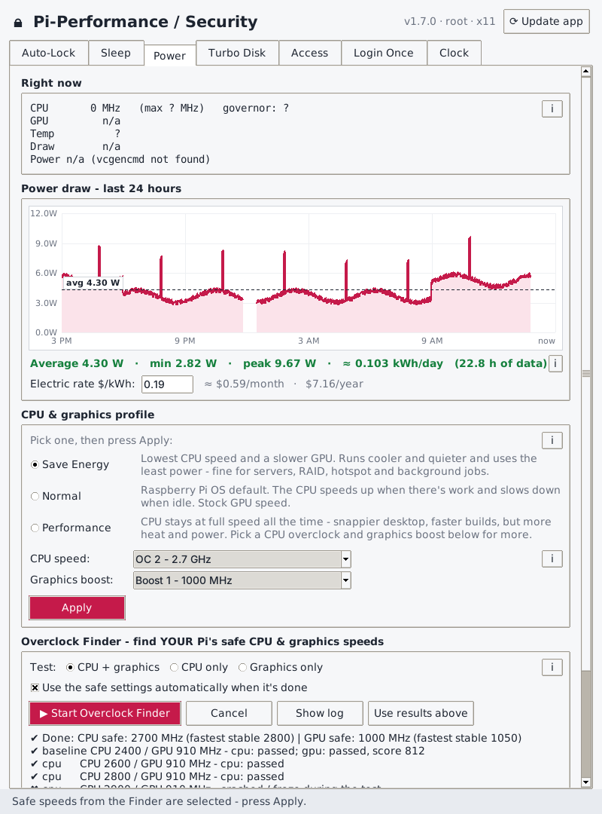
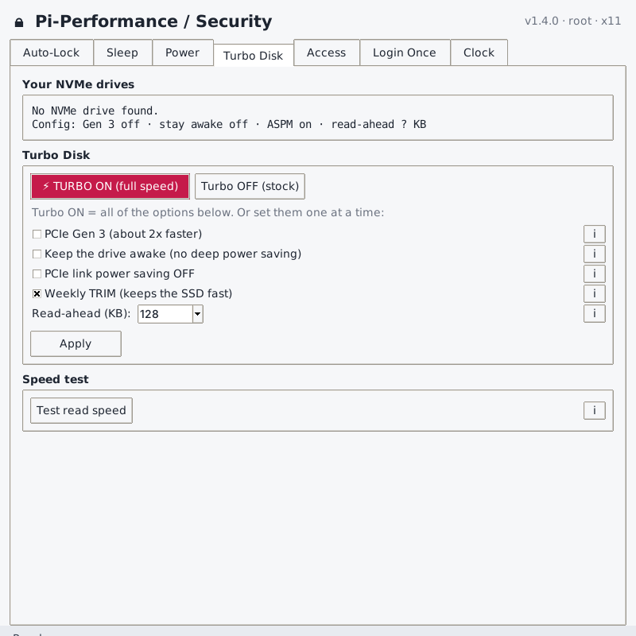
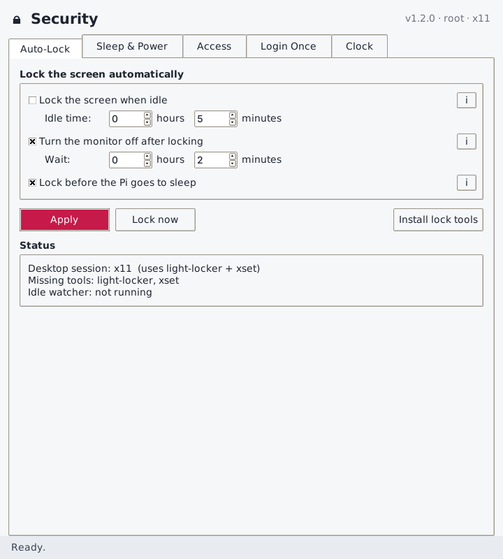
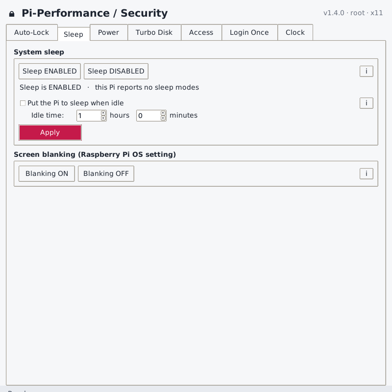
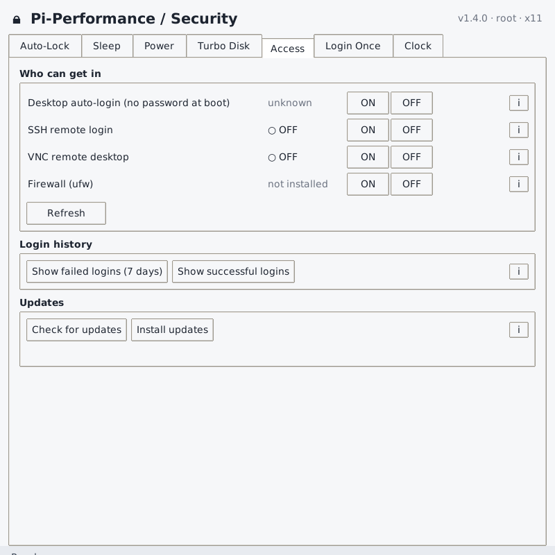
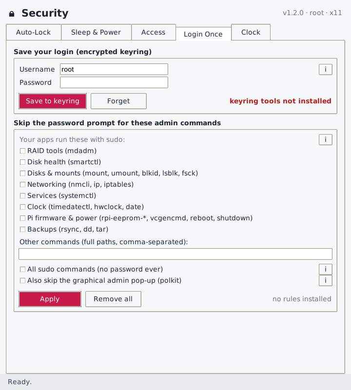
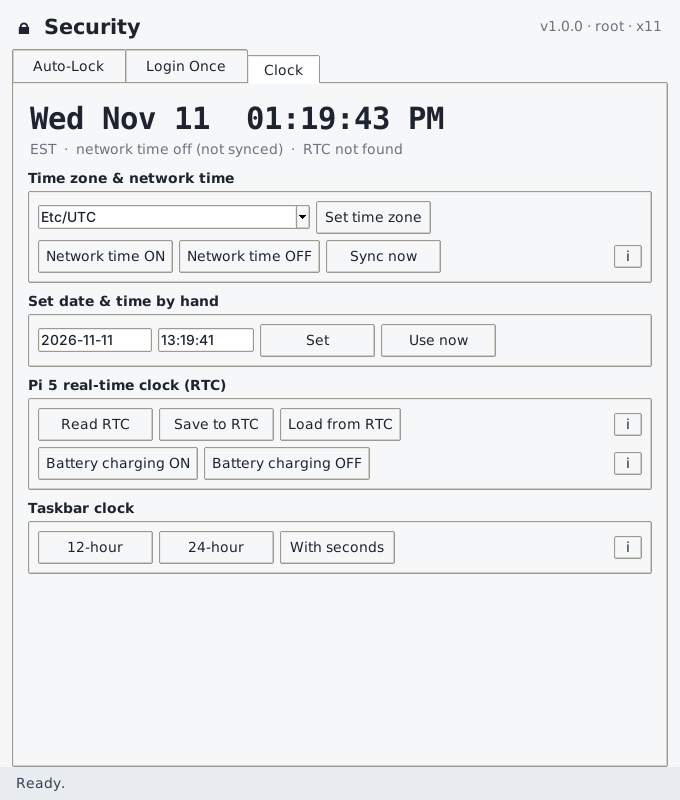

# Pi-Performance / Security for Raspberry Pi 5

A small desktop app for Raspberry Pi OS (Bookworm / Trixie) with seven tabs:

| Power | Turbo Disk | Auto-Lock | Sleep |
|---|---|---|---|
|  |  |  |  |

| Access | Login Once | Clock |
|---|---|---|
|  |  |  |

*(The Power screenshot shows example data.)*

## Power
- **Live readout**: CPU and GPU speed, governor, temperature, power draw in watts, and under-voltage / throttling warnings.
- **24-hour power graph** with average, min and peak watts, **kWh per day**, and estimated **cost per month and year** at your electric rate. The `pi-powerlog` service records the Pi 5's power chip once a minute, so the graph keeps filling while the app is closed. (It measures the Pi board and what it powers - a good estimate, not a wall-plug meter.)
- **CPU & graphics profiles**:
  - **Save Energy**: CPU at its lowest speed (`powersave`), GPU slowed to 500 MHz.
  - **Normal**: Raspberry Pi OS default (`ondemand`), stock GPU.
  - **Performance**: CPU always at full speed (`performance`). Optional **Overclock** to CPU 2.8 GHz and GPU 1 GHz (needs a cooler and the 27 W supply).
  - The CPU part applies instantly and is kept across reboots. The GPU/overclock part goes in a marked block in `config.txt` (backup saved) and needs a reboot.
- **Restart** and **Shut down** buttons.

## Turbo Disk
- Shows each NVMe drive, its model, and the PCIe link speed it's running at right now.
- **⚡ TURBO ON** puts the NVMe at full speed in one click:
  - **PCIe Gen 3** (about 2x faster than the default Gen 2)
  - **Keeps the drive awake**: no deep power-saving states, so no wake-up lag
  - **PCIe link power saving off** (ASPM)
  - **Bigger read-ahead** (2 MB) for fast big-file copies and backups
  - **Weekly TRIM**
- **Turbo OFF** puts everything back to stock. You can also set each option on its own.
- **Speed test**: reads 1 GB straight from the drive (read-only) and shows the MB/s.

## Auto-Lock
- Lock the screen after an idle time you set in **hours and minutes**, turn the monitor off a set time (hours + minutes) after it locks, and lock before the Pi sleeps.
- **Lock now** button (same as Ctrl+Alt+L).
- Wayland desktop (labwc / wayfire): uses `swayidle` + `swaylock` (+ `wlopm` for monitor off).
  X11 desktop: uses `light-locker` with the X screensaver timer.
- Starts at every login. Adds a marked block to `~/.config/labwc/autostart` (the rest of the file is left alone).

## Sleep
- **Sleep ENABLED / DISABLED** for the whole Pi (masks the systemd sleep targets). When it's disabled, nothing can put the Pi to sleep, which is the safe setting for an always-on Pi (servers, RAID, hotspot). The status line shows which sleep modes your Pi supports.
- **Put the Pi to sleep when idle** after a set time in hours + minutes (Wayland desktop; only while sleep is enabled).
- Raspberry Pi OS **screen blanking** on/off. Turn it off if you use the monitor-off timer on the Auto-Lock tab.

## Access
- **Desktop auto-login** on/off. With auto-login on, anyone who reboots the Pi gets in with no password, so the auto-lock doesn't protect you.
- **SSH** and **VNC** on/off, with live status.
- **Firewall (ufw)** on/off. "ON" keeps SSH (22) and VNC (5900) open so you can't lock yourself out, and blocks everything else coming in.
- **Login history**: failed and successful logins (SSH, sudo, desktop) from the last 7 days.
- **Updates**: check for and install system updates.

## Login Once
- **Save to keyring**: checks your password with sudo, then stores it **encrypted** in the login keyring (gnome-keyring). The keyring unlocks when you log in, so your password is entered once per login.
- **Skip the password prompt** for chosen admin commands (RAID/mdadm, smartctl, mounts, networking, systemctl, clock, Pi firmware/power, backups, or your own paths). Rules go in `/etc/sudoers.d/60-pi-security` and are checked with `visudo` before install, so a bad rule can't break sudo.
- Optional: all sudo commands without a password, and skip the graphical polkit prompt. Each of these has a warning.
- **`pi-sudo`**: use it in your own apps and scripts in place of `sudo`. It uses the saved password:
  ```bash
  pi-sudo mdadm --detail /dev/md0
  ```
  In Python:
  ```python
  pw = subprocess.run(["secret-tool","lookup","service","pi-security","user",getpass.getuser()],
                      capture_output=True, text=True).stdout
  ```

> Note: Raspberry Pi OS often gives the first user passwordless sudo already (`/etc/sudoers.d/010_pi-nopasswd`). The app shows "sudo never asks for a password" when that's the case.

## Clock
- Live clock with time zone, network-time sync status and RTC status.
- Set the **time zone**, turn **network time** (NTP) on/off, **Sync now**.
- Set the **date & time by hand** (turns NTP off first if needed).
- Pi 5 **RTC**: Read, Save system time to RTC, Load from RTC.
- **RTC battery charging** on/off (`dtparam=rtc_bbat_vchg=3000000` in config.txt). Only use this with a **rechargeable** ML-2020 cell, never a CR2032. Needs a reboot.
- **Taskbar clock**: 12-hour, 24-hour, or with seconds.

Every setting has an **i** button that explains what it does.

## Install
```bash
git clone https://github.com/CharlesPhillips3/security.git
cd security
bash install.sh
```
Open it from **Menu → Preferences → Pi-Performance / Security**, or run `pi-security`.
Log out and back in once after installing so the keyring unlocks at login.

## Uninstall
```bash
bash uninstall.sh
```
This removes the app, its autostart entry, the saved keyring password, and its sudoers/polkit rules, the power logger and its data, and re-enables sleep. Put Power on **Normal** and Turbo Disk **OFF** first if you want stock boot settings back. Auto-login, SSH, VNC, firewall and RTC settings stay as you left them.

## Files
| File | What it is |
|---|---|
| `security.py` | The app (Python 3 + Tkinter) |
| `pi-sudo` | Runs sudo with the password saved in the keyring |
| `pi-powerlog`, `pi-powerlog.service` | Background power-draw logger for the 24-hour graph |
| `install.sh` / `uninstall.sh` | Installer / remover |
| `security.desktop`, `security.png` | Menu entry and icon |

MIT License.
